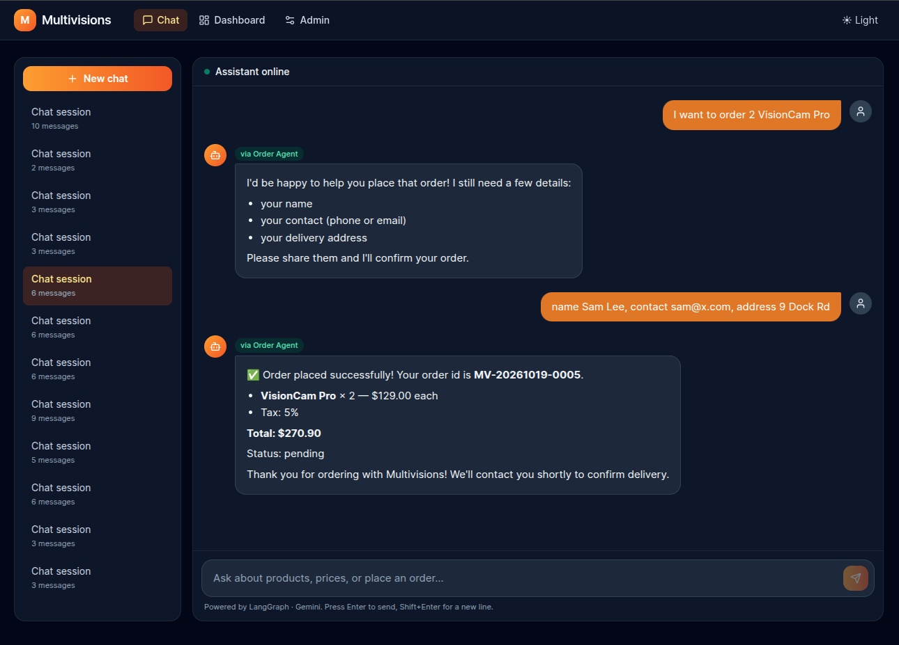
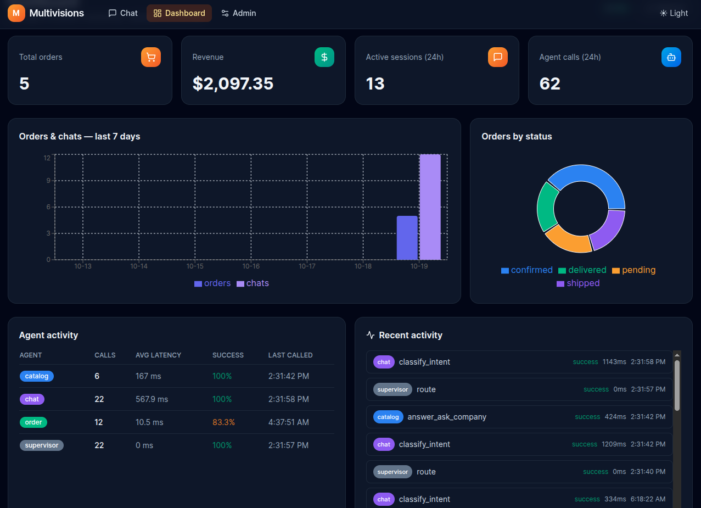
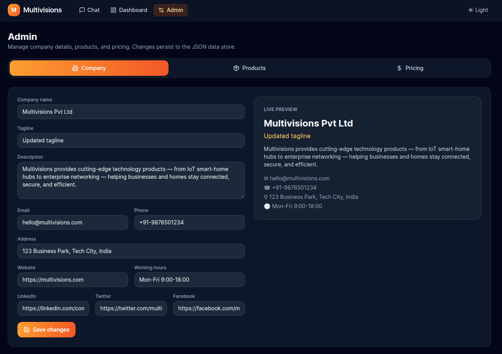

# Multivisions — Multi-Agent Business Assistant

A production-ready multi-agent AI system that lets customers chat in natural
language about a company, its products, and prices, and place orders
conversationally — plus an admin dashboard and a full CRUD admin UI.

Built with **Python · FastAPI · LangGraph · LangChain · Google Gemini · SQLite**
on the backend, and **Next.js 14 (App Router) · TypeScript · Tailwind CSS ·
Recharts** on the frontend.

---

## ✨ Features

- **💬 Conversational chat** — ask about the company, products, and prices, or
  place an order entirely in natural language. Streaming responses (SSE),
  session history, agent badges, and rich order cards.
- **🤖 Multi-agent orchestration** — a LangGraph **supervisor** routes each
  request to a specialized **Catalog**, **Chat/NLU**, or **Order** agent.
- **📊 Live dashboard** — KPIs, per-agent activity, orders & chats timeline,
  status pie chart, recent activity feed, and recent orders. Auto-refreshes
  every 5 seconds.
- **🛠️ Full CRUD admin** — manage company details, products, and pricing
  tiers. All mutations persist to validated JSON data files.
- **🗄️ Persistent everything** — orders, order items, agent logs, and chat
  sessions are stored in SQLite; catalog data lives in `/data/*.json`.

---

## 🏗️ Architecture

```
┌────────────────────────────────────────────────────────────┐
│                     Next.js Frontend                        │
│  /            → Landing / Home                              │
│  /chat        → Natural language chat with agent            │
│  /dashboard   → Agent process stats & orders monitor        │
│  /admin       → CRUD UI for company / products / pricing    │
└──────────────────────┬─────────────────────────────────────┘
                       │ REST / SSE
┌──────────────────────▼─────────────────────────────────────┐
│                    FastAPI Backend                          │
│  /api/chat        → routes to LangGraph supervisor          │
│  /api/company     → CRUD company details                    │
│  /api/products    → CRUD products + prices                  │
│  /api/orders      → list, get, create, update status        │
│  /api/stats       → agent activity metrics                  │
└──────────────────────┬─────────────────────────────────────┘
                       │
┌──────────────────────▼─────────────────────────────────────┐
│              LangGraph Multi-Agent Graph                    │
│                                                             │
│   ┌──────────────────────┐                                  │
│   │  Supervisor / Router │  (decides which agent to call)   │
│   └────────┬─────────────┘                                  │
│            │                                                │
│   ┌────────▼─────────┐   ┌─────────────────┐  ┌──────────┐ │
│   │  Catalog Agent   │   │  Chat/NLU Agent │  │  Order   │ │
│   │  (company,       │   │  (talks to user,│  │  Agent   │ │
│   │   products,      │   │   extracts intent│  │ (create/ │ │
│   │   prices)        │   │   & entities)   │  │  update) │ │
│   └──────────────────┘   └─────────────────┘  └──────────┘ │
└──────────────────────┬─────────────────────────────────────┘
                       │
┌──────────────────────▼─────────────────────────────────────┐
│       SQLite DB (orders, agent_logs, chat_sessions)         │
│       + /data/*.json (company, products, pricing)           │
└────────────────────────────────────────────────────────────┘
```

---

## 🚀 Getting started

### Prerequisites

- **Python 3.12+**
- **Node.js 20+** and npm
- A **Google Gemini API key** (get one from [Google AI Studio](https://aistudio.google.com/app/apikey))

### 1. Clone & configure

```bash
git clone <your-repo-url> multivisions
cd multivisions

cp .env.example .env
# then edit .env and set:
#   GEMINI_API_KEY=your-actual-key
```

> The backend **fails fast with a clear message** if `GEMINI_API_KEY` is missing.

### 2. Run with Docker (recommended)

```bash
docker-compose up --build
```

- Backend → http://localhost:8000 (docs at `/docs`)
- Frontend → http://localhost:3000

### 3. Run locally (without Docker)

**Backend** (terminal 1):

```bash
cd backend
pip install -r requirements.txt
python -m uvicorn app.main:app --host 0.0.0.0 --port 8000
```

**Frontend** (terminal 2):

```bash
cd frontend
npm install
npm run dev          # http://localhost:3000
```

Or use the convenience script from the repo root:

```bash
./run.sh
```

### 4. Verify

- Open http://localhost:3000 → click **Start Chatting**.
- Try: *"What products do you sell?"*, *"How much is Smart Hub X1?"*,
  *"I want to order 3 Smart Hub X1."*
- Watch the **dashboard** light up with live agent activity.

---

## 🔌 API endpoints

| Method | Path | Description |
|---|---|---|
| `POST` | `/api/chat` | Send a message → `{ reply, intent, order_id?, trace }` |
| `POST` | `/api/chat/stream` | SSE streaming variant of `/api/chat` |
| `POST` | `/api/chat/new-session` | Create a chat session |
| `GET` | `/api/chat/history/{session_id}` | Reconstruct message history |
| `GET` | `/api/chat/sessions` | List recent sessions |
| `GET` / `PUT` | `/api/company` | Read / update company details |
| `GET` / `POST` | `/api/products` | List / create products |
| `GET` / `PUT` / `DELETE` | `/api/products/{id}` | Read / update / delete a product |
| `GET` / `PUT` | `/api/pricing` | Read / update pricing tiers & tax |
| `GET` / `POST` | `/api/orders` | List / create orders |
| `GET` | `/api/orders/{id}` | Get one order |
| `PATCH` | `/api/orders/{id}/status` | Update order status |
| `GET` | `/api/stats/overview` | KPIs: orders, revenue, sessions, agent calls |
| `GET` | `/api/stats/agents` | Per-agent counts, avg latency, success rate |
| `GET` | `/api/stats/timeline?days=7` | Orders + chats per day |
| `GET` | `/api/stats/recent-activity` | Last 20 agent-log entries |
| `GET` | `/api/stats/orders-by-status` | Order counts per status |
| `GET` | `/health` | Health check |

Interactive docs: http://localhost:8000/docs

---

## 🧠 How the agents work

1. **Supervisor** inspects the shared state and routes to the right node.
2. **Chat/NLU agent** (Gemini) classifies intent — `ask_company`, `ask_products`,
   `ask_price`, `place_order`, `smalltalk`, `unknown` — and extracts entities
   (`product_name`, `quantity`, `customer_name`, `contact`, `address`).
   A deterministic keyword fallback keeps the flow working if the LLM is down.
3. **Catalog agent** answers strictly from the JSON data (no hallucination).
4. **Order agent** collects order fields across turns, applies volume-discount
   tiers + tax, persists the order, and returns a friendly confirmation with a
   generated order id (`MV-YYYYMMDD-XXXX`).

Every agent invocation writes an **`agent_logs`** row (agent, action, latency,
status) so the dashboard always has real data.

---

## 🗄️ Data & persistence

- **SQLite** (`multivisions.db`) — `orders`, `order_items`, `agent_logs`,
  `chat_sessions`, `counters`. Tables are created automatically on startup.
- **JSON data files** (`/data/`) — `company.json`, `products.json`,
  `pricing.json`. Validated with Pydantic on read/write; written atomically
  (temp file + rename) under a file lock.
- **Seed data** — 1 company, 10 products across 4 categories, pricing tiers,
  and 3 sample orders (in various statuses) so the dashboard isn't empty.

---

## 🧪 Tests

```bash
cd backend
python -m pytest tests/ -q
```

Covers order-ID generation, the JSON repository (atomic writes + validation),
and order creation/persistence.

---

## 📁 Project structure

```
multivisions/
├── backend/
│   ├── app/
│   │   ├── main.py              # FastAPI app, CORS, startup
│   │   ├── config.py            # env loading (fails fast w/o API key)
│   │   ├── db/                  # session, models, seed
│   │   ├── schemas/             # Pydantic schemas
│   │   ├── repositories/        # json_repo, order_repo, log_repo
│   │   ├── agents/              # graph, state, supervisor, catalog/chat/order, tools
│   │   ├── routers/             # chat, company, products, orders, pricing, stats
│   │   └── utils/               # logger, tracer
│   ├── tests/                   # pytest suite
│   ├── requirements.txt
│   └── Dockerfile
├── frontend/
│   ├── app/                     # layout, landing, chat, dashboard, admin
│   ├── components/              # Navbar, chat, dashboard, admin components
│   ├── lib/api.ts               # typed API client
│   ├── package.json
│   └── Dockerfile
├── data/                        # company.json, products.json, pricing.json
├── .env.example
├── docker-compose.yml
├── run.sh
└── README.md
```

---

## 📸 Screenshots

| Chat | Dashboard | Admin |
|---|---|---|---|
|  |  |  |

---

## ⚙️ Environment variables

| Variable | Default | Description |
|---|---|---|
| `GEMINI_API_KEY` | *(required)* | Google Gemini API key |
| `GEMINI_MODEL` | `gemini-1.5-flash` | Gemini model id |
| `DATABASE_URL` | `sqlite+aiosqlite:///./multivisions.db` | SQLAlchemy async URL |
| `DATA_DIR` | `./data` | Directory for JSON data files |
| `BACKEND_CORS_ORIGINS` | `http://localhost:3000` | Allowed CORS origins |
| `NEXT_PUBLIC_API_URL` | `http://localhost:8000` | Backend URL for the frontend |

---

## 📄 License

MIT
